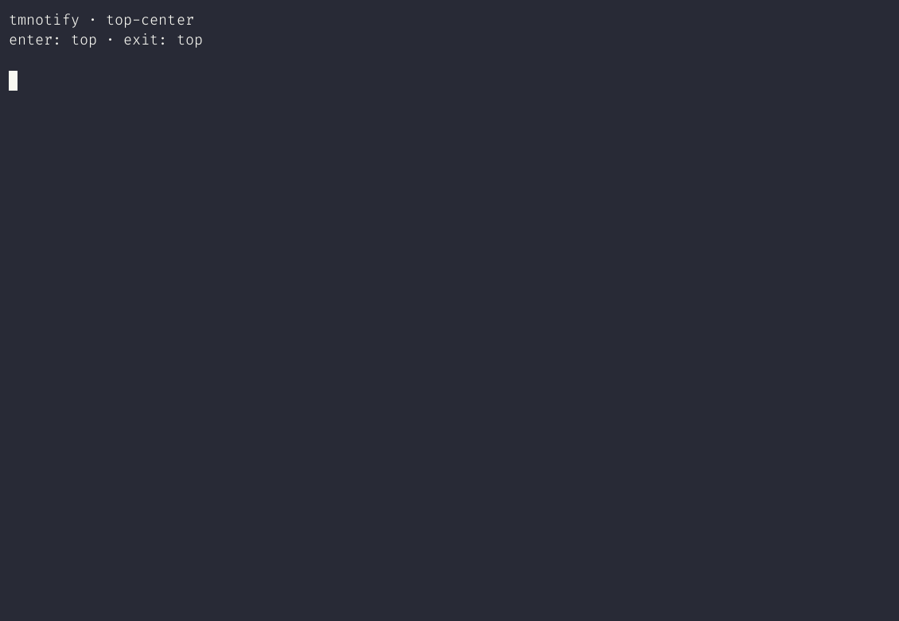
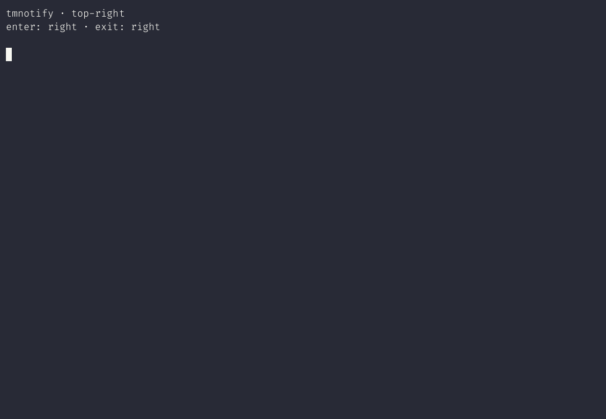
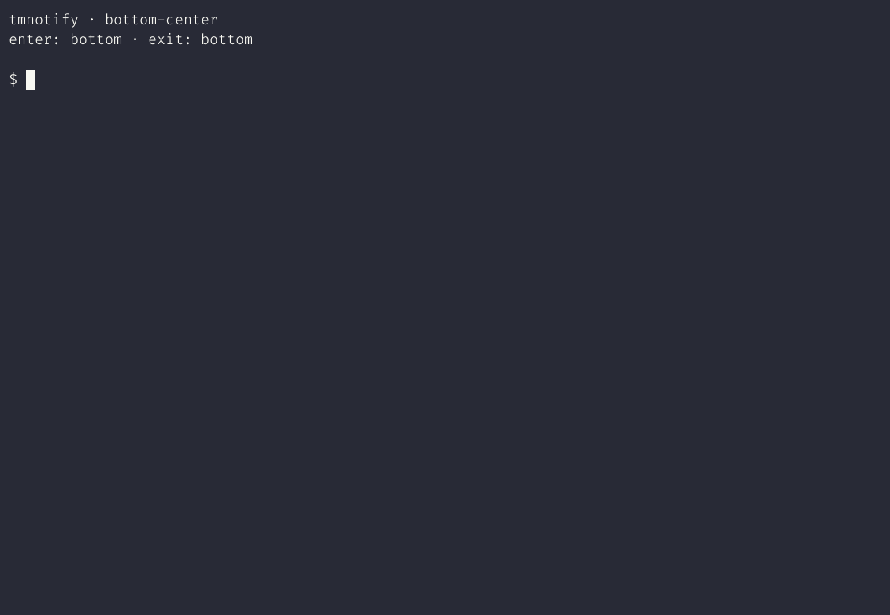
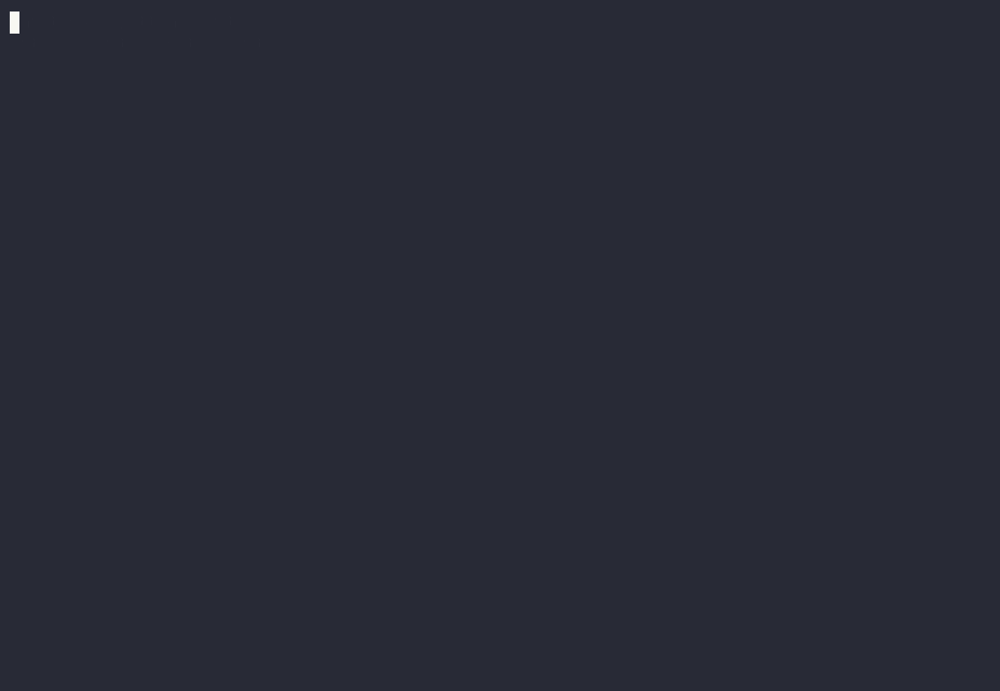

# Toast placement animation demos

Each GIF records one Toast at the named placement on an isolated tmux server.
The Toast enters from the window edge that owns its placement and exits back to
the same edge.

| Position | Motion | Demo |
| --- | --- | --- |
| `top-left` | in from left, out to left |  |
| `top-center` | in from top, out to top |  |
| `top-right` | in from right, out to right |  |
| `bottom-left` | in from left, out to left |  |
| `bottom-center` | in from bottom, out to bottom |  |
| `bottom-right` | in from right, out to right |  |

Regenerate all six GIFs from the repository root:

```bash
demo/record-placement-gifs.sh
```

The recorder needs `asciinema` and `agg` in addition to `cargo` and `tmux`. Set
`CAST_DIRECTORY` to keep the intermediate asciicast files, or `SKIP_BUILD=1` to
reuse an already built `target/debug/tmnotify`.
